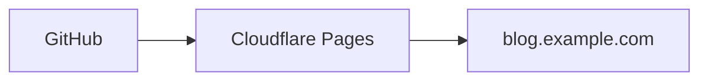

# 文章写作规范

## 内容位置

文章统一放在 `src/content/posts/`，当前正式支持 Markdown 文件。可以使用单文件，也可以用目录把文章与图片放在一起：

```text
src/content/posts/
├── python-typing.md
└── agent-notes/
    ├── cover.png
    ├── diagram.png
    └── index.md
```

文章 slug 由 Content Collection 根据文件路径生成，不通过 Frontmatter 手工维护。文件路径一旦公开就应视为永久 URL 的一部分；重命名或移动文件前，要考虑旧链接失效并在预览中确认最终路由。

当前没有单独启用 Astro MDX 集成，不要将 `.mdx` 当作已验证的发布格式。

## 创建文章

```sh
pnpm new-post my-first-post
```

命令会创建 `src/content/posts/my-first-post.md`。脚本生成的是待编辑模板，其中已显式设置 `draft: true`，允许 `description` 暂时为空。发布前仍必须补齐摘要，并将 `draft` 改为 `false`。

推荐的新文章起点：

```yaml
---
title: "文章标题"
published: 2026-07-31
updated: 2026-07-31
description: "用一到两句话准确概括文章解决的问题和读者收获。"
image: "./cover.png"
tags: [Python, Astro]
category: "工程实践"
draft: true
lang: "zh_CN"
---
```

完成审核后，将 `draft` 改为 `false`，再执行完整检查和生产预览。

## Frontmatter Schema

Schema 定义在 `src/content/config.ts`。当前可用字段如下：

| 字段 | 类型 | 必填 | 说明 |
| --- | --- | --- | --- |
| `title` | `string` | 是 | 去除首尾空白后必须非空；用于页面标题、文章卡片和结构化数据。 |
| `published` | `date` | 是 | 首次发布日期。建议使用 `YYYY-MM-DD` 或完整 ISO 8601。 |
| `updated` | `date` | 否 | 实质性更新日期；未提供时结构化数据使用发布日期作为修改日期。 |
| `draft` | `boolean` | 否 | Schema 中省略时默认 `false`；`new-post` 模板会显式写入 `true`。生产构建只排除明确为 `true` 的文章。 |
| `description` | `string` | 公开文章必填 | 草稿可为空；公开文章去除首尾空白后必须非空。用于列表、SEO、RSS 和 JSON-LD。 |
| `image` | `string` | 否 | 文章封面。可为空、使用文章相对路径、`public/` 根路径或完整 HTTP(S) URL。 |
| `tags` | `string[]` | 否 | 默认空数组；每个标签去除首尾空白且不能为空；用于文章元数据、归档筛选和 SEO `article:tag`。 |
| `category` | `string \| null` | 否 | 默认空字符串；值会去除首尾空白，空值会显示为“未分类”。 |
| `lang` | `string` | 否 | 默认空字符串；为空时继承站点语言 `zh_CN`。 |

以下字段仅供构建内部计算，不要写入 Frontmatter：

```text
prevTitle
prevSlug
nextTitle
nextSlug
```

需求规划中提到的 `cover`、`coverAlt`、`series`、`featured`、`slug`、`author` 和逐文章 `license` 尚未加入当前 Schema。封面字段目前沿用 Fuwari 的 `image`，许可证由站点配置统一控制。

## 标题与摘要

- `title` 应描述文章主题，不要重复附加站点名。页面会自动生成 `文章标题 | Example Lab`。
- `description` 应独立可读，不要依赖正文第一段，也不要只复制标题。
- 摘要会用于文章列表、`meta description`、Open Graph、Twitter Card、RSS 和 BlogPosting JSON-LD，应避免 Markdown 标记和无意义开场白。
- 更新文章内容时，如结论或代码有实质变化，应填写 `updated`；仅修正错别字通常不必更新。

## 标签与分类

- 一篇文章可以有多个标签，但只有一个分类。
- 标签用于描述技术或主题，例如 `Python`、`Astro`、`Agent`。
- 分类用于更稳定的内容分组，例如 `工程实践`、`学习笔记`。
- Schema 会去除标签和分类的首尾空白；大小写仍会影响聚合结果。选定名称后保持一致，不要同时使用 `AI`、`Ai` 和 `ai`。
- 没有明确分类时使用空字符串或省略字段，不要手工写“未分类”。

标签和分类链接会进入 `/archive/`，分别使用 `tag`、`category` 或 `uncategorized=true` 查询参数过滤。

## 封面与正文图片

### 文章相对图片

将封面和文章放在同一目录：

```yaml
image: "./cover.png"
```

相对封面会通过公开文章封面清单解析，再交给 Astro 图片组件显示。生产构建会为它生成 1200x630、WebP、质量 82 的优化社交图片，并将最终 `_astro/` 地址转换为绝对 URL，用于 `og:image`、`twitter:image` 和 BlogPosting JSON-LD。封面文件不存在或位于 `src/` 之外时，构建会失败并指出来源文章。

### Public 图片

文件放在 `public/images/posts/cover.png` 时：

```yaml
image: "/images/posts/cover.png"
```

页面按原路径读取，SEO 会将其转换为 `https://blog.example.com/images/posts/cover.png`。文件名和路径修改后需要手动维护引用。

### 远程图片

```yaml
image: "https://example.com/path/cover.png"
```

完整 HTTP(S) 地址可用于页面和社交元数据，但会依赖第三方可用性、缓存策略与授权。正式文章优先使用本站可控资源。

### 正文图片

使用标准 Markdown 并始终提供有意义的替代文本：

```markdown

```

正文图片和文章封面可点击放大。文章封面暂时使用文章标题作为替代文本回退，当前 Schema 尚无 `coverAlt`；不要让封面承担正文必须表达的信息。`src/` 下可被 Astro 识别的本地正文图片会获得响应式 `srcset`、`sizes` 以及 `width`/`height`，默认懒加载和异步解码。文章封面、卡片和横幅由组件传入各自的断点和 `sizes`。

图片 Caption 使用 Markdown 图片链接的 `title`：

```markdown

```

只有图片独占一个段落时才会生成语义化 `<figure>` 和 `<figcaption>`；`title` 会被消费为 Caption，不会再作为浏览器悬浮提示。无论是否有 Caption，`alt` 都必须准确描述图片，装饰性图片才可使用空替代文本。

> [!WARNING]
> 生产构建会通过 `remarkDraftImageGuard` 移除草稿正文中的图片节点，并让 `published-post-images` 只导入公开文章引用的相对封面，因此仅由草稿引用的媒体不会进入生产 `dist/_astro/`。同一文件若也被公开文章引用，仍会作为公开依赖输出。开发环境会保留草稿媒体以便预览；`public/` 会整体发布，仓库和 `public/` 都不是私密存储，敏感图片不得放入其中。

## 当前 Markdown 能力

| 能力 | 当前状态 |
| --- | --- |
| 标题、列表、引用、链接、表格等标准 Markdown | 支持 |
| 代码高亮、语言标识、复制按钮、代码块标题和行号 | Expressive Code 已接入 |
| 数学公式 | KaTeX 已接入 |
| GitHub 风格提示块 | 支持 `NOTE`、`TIP`、`IMPORTANT`、`WARNING`、`CAUTION` |
| 指令式提示块与 GitHub 仓库卡片 | Fuwari 插件已接入 |
| 阅读时间与字数 | 构建时自动计算，不写入 Frontmatter |
| 标题锚点与文章目录 | 已接入 |
| 图片点击放大 | PhotoSwipe 已接入；使用 `currentSrc`、固有尺寸和 `alt`，core 按打开动作懒加载 |
| Mermaid | 已接入；Mermaid `11.16.0` 客户端动态加载，`strict` 安全模式，主题/Swup 变化后重绘 |
| MDX | 尚未单独启用或验证 |
| 图片 Caption | 已接入；Markdown 图片 `title` 生成 `figure`/`figcaption` |
| `coverAlt` | 尚未加入 Schema；封面回退使用文章标题 |

代码块标题示例：

````markdown
```ts title="src/example.ts"
export const answer = 42;
```
````

GitHub 风格提示块示例：

```markdown
> [!NOTE]
> 这里是需要读者注意的补充信息。
```

数学公式示例：

```markdown
$$
E = mc^2
$$
```

Mermaid 图表示例：

````markdown

````

`title="..."` 是代码围栏元数据，会成为图表 Caption 和默认无障碍名称。建议同时写 Mermaid 原生的 `accTitle` 与 `accDescr`，让图表在 SVG 渲染后拥有更准确的标题和描述。Mermaid 只在浏览器端按需加载，使用严格安全模式；渲染失败或禁用 JavaScript 时，原始源码仍以 Expressive Code 样式显示。成功渲染后源码会隐藏，图表容器使用 `data-pagefind-ignore`，避免 Pagefind 重复索引实现细节。

## 草稿与发布

`pnpm dev` 会显示草稿，`pnpm build` 会过滤草稿。生产过滤同时作用于文章详情、首页、归档、标签、分类、RSS、Sitemap 和 Pagefind 的文章索引，并通过 Markdown 图片 guard 与公开封面清单隔离草稿媒体。`public/` 目录不参与这项过滤，会按原路径复制。

发布前执行：

```sh
pnpm check
pnpm type-check
pnpm exec biome check ./src
pnpm build
pnpm preview
```

发布检查清单：

1. `draft: false`，标题和摘要均非空。
2. 日期、标签、分类和封面路径正确；本地封面在生产预览中生成响应式显示和绝对社交图片 URL。
3. Mermaid 图表包含可读的 `title=`，复杂图表补充 `accTitle`/`accDescr`，并在浅色、深色和页面切换后检查渲染与源码回退。
4. 正文没有私人信息、Token、密码或未经授权的数据。
5. 代码示例可复现，外部链接可访问，图片具有替代文本、Caption（如需要）和使用许可。
6. 生产预览中页面 URL、目录、上一页/下一页、RSS、Pagefind 和分享元数据符合预期。
