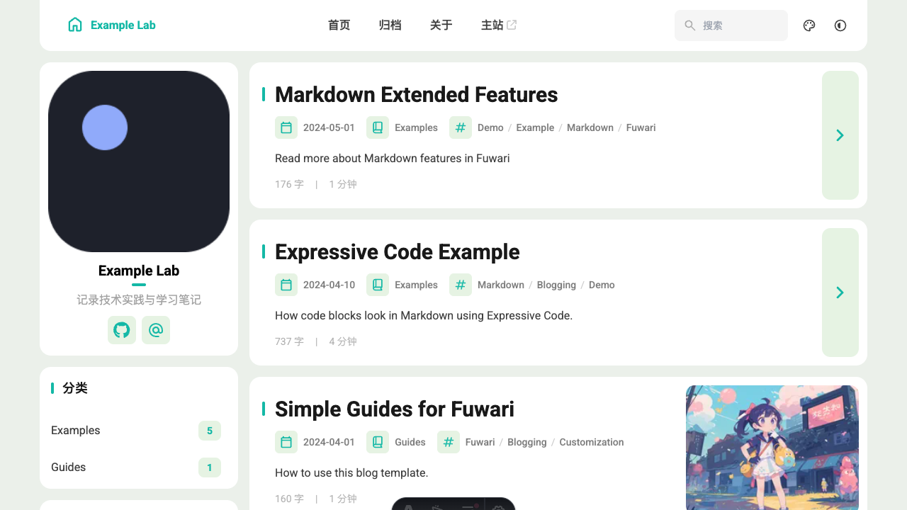
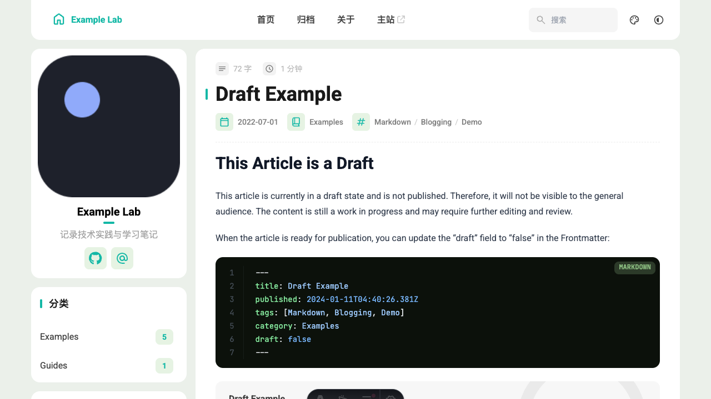

# 使用这个模板搭建个人博客

这篇文档讲两件事：

1. 你怎么把这个仓库改成自己的个人博客。
2. AI 怎么借助 `deploy-astro-blog` skill 一键把博客部署到 Cloudflare Pages。

## 1. 先看成品长什么样

首页：



文章页和评论区：



## 2. 最短搭建流程

```sh
corepack enable
pnpm install --frozen-lockfile
pnpm dev
```

然后改这几个地方：

- `src/config/site.ts`：站点名、博客域名、主站、邮箱、作者简介。
- `src/content/posts/`：你的文章。
- `public/`：公开静态资源。

写第一篇文章：

```sh
pnpm new-post my-first-post
```

文章正文直接写 Markdown。发布前把 `draft: true` 改成 `false`。

## 3. 文章写法

建议每篇文章都带这些字段：

```yaml
---
title: "文章标题"
published: 2026-07-31
description: "用一到两句话概括文章。"
tags: ["Astro", "博客"]
category: "工程实践"
draft: false
---
```

正文就按标准 Markdown 写，图片用相对路径：

```md

```

## 4. 评论怎么用

这个模板的评论是本地评论，不需要数据库。

- 第一次打开评论区时，会随机给你一个昵称。
- 你也可以自己改昵称。
- 昵称和评论会保存在当前浏览器。
- 换浏览器或清理站点数据后，本地评论不会自动同步。

## 5. AI 一键部署到 CDN

把 `skills/deploy-astro-blog` 安装到 Codex skills 目录：

```sh
mkdir -p ~/.codex/skills
cp -R skills/deploy-astro-blog ~/.codex/skills/deploy-astro-blog
```

然后把下面这段直接发给 AI：

```text
使用 deploy-astro-blog skill，帮我部署一个 Astro/Fuwari 个人博客到 Cloudflare Pages。

我的输入如下：
- 模式：new
- 项目目录：/absolute/path/my-blog
- 博客名称：Example Lab
- 项目 slug：example-blog
- 博客 URL：https://blog.example.com
- 主站 URL：https://example.com
- 描述：记录技术实践与学习笔记。
- 主题方向：技术写作,项目记录,学习笔记,工程实践
- GitHub 仓库：example/example-blog
- 仓库可见性：Public 或 Private
- 是否绑定自定义域：是/否
- 自定义域：blog.example.com

请先 scaffold、安装依赖、检查构建，再配置 GitHub 仓库和 Cloudflare Pages。
外部变更前先告诉我将要改什么。
```

AI 应该做的事：

1. 本地生成项目。
2. 运行 `pnpm check`、`pnpm type-check`、`pnpm exec biome check ./src`、`pnpm build`。
3. 创建 GitHub 仓库并推送 `main`。
4. 配置 Cloudflare Pages Git 集成。
5. 需要时只绑定你授权的博客子域。

## 6. 推荐发布节奏

1. 写文章。
2. 本地预览。
3. `draft: false`。
4. `pnpm build`。
5. 推送到 GitHub。
6. 让 Cloudflare Pages 自动发布。

这样最稳，也最容易回滚。
